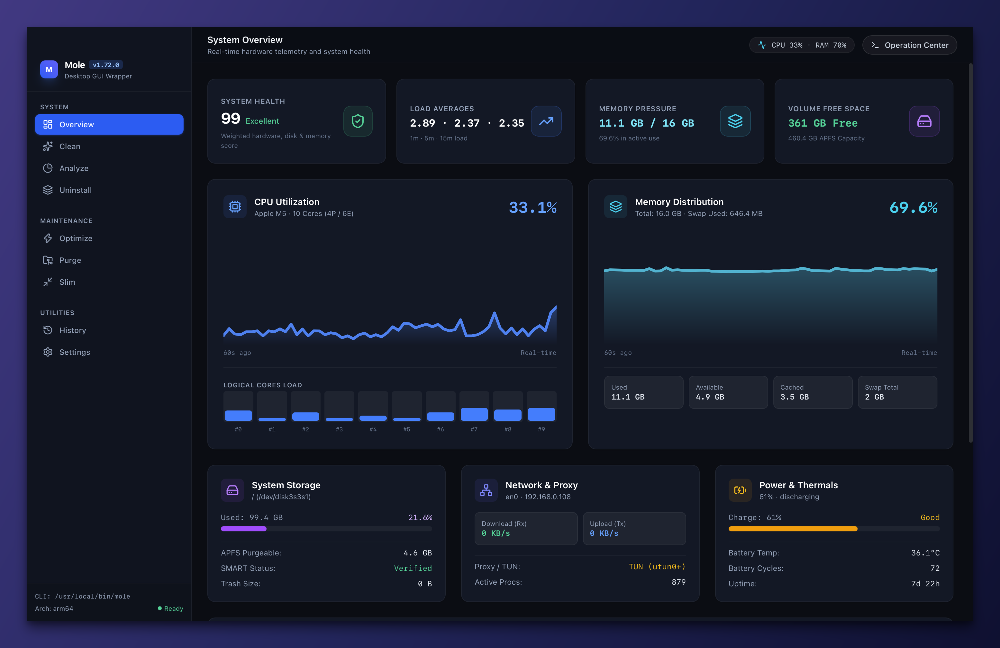
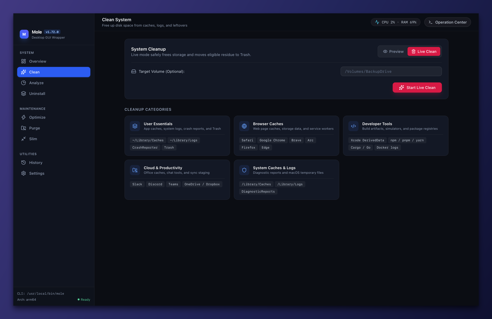
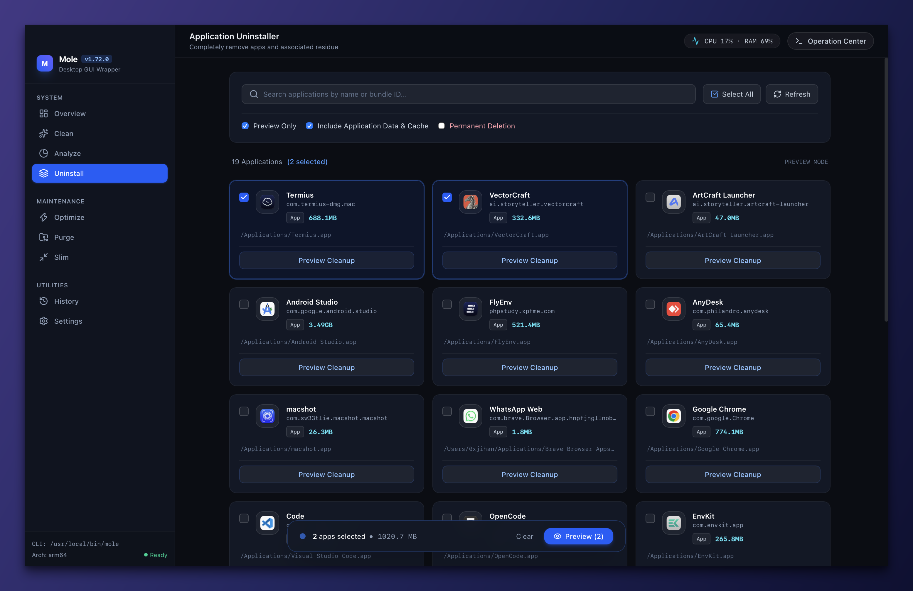
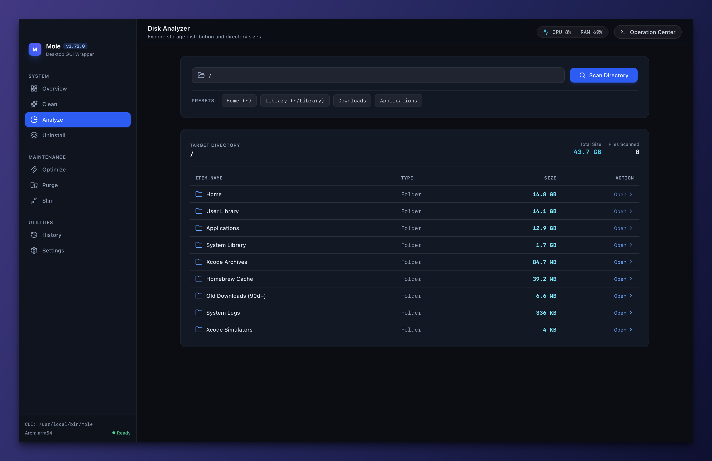
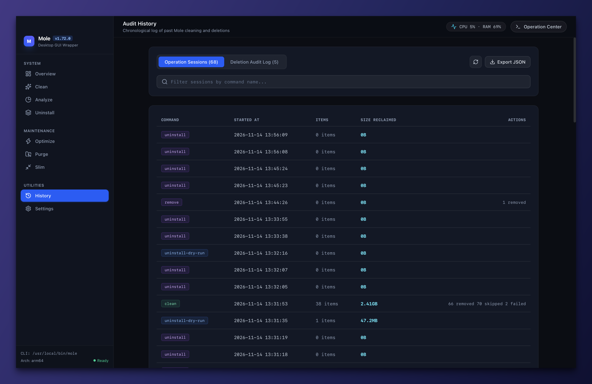

<div align="center">


# Mole GUI

**A high-performance, native macOS graphical desktop wrapper for the original Mole maintenance CLI.**

Real-time hardware telemetry, deep system cleaning, batch application uninstallation, macOS service optimization, and developer build purging—powered 100% by the authentic Mole CLI.

<p>
  <a href="https://github.com/0xJihan/Mole-GUI/releases/latest">
    
  </a>
  <a href="https://supportkori.com/0xjihan">
    
  </a>
  
  
  
  
</p>

[**Download for macOS →**](https://github.com/0xJihan/Mole-GUI/releases/latest) · [**💖 Support Developer**](https://supportkori.com/0xjihan) · [Screenshots](#screenshots) · [Why Mole GUI?](#why-mole-gui) · [Features](#features) · [Installation](#installation) · [Architecture](#architecture) · [Developer & Support](#developer--support)

</div>

---



<p align="center"><sub><b>The Mole GUI window.</b> Live hardware telemetry and system health at a glance, coupled with full graphical control over the authentic Mole CLI.</sub></p>

---

## Screenshots

<table>
  <tr>
    <td width="50%" valign="top">
      
      <p align="center"><sub><b>Hardware Telemetry</b><br/>Real-time CPU, GPU, Memory, and Disk stats.</sub></p>
    </td>
    <td width="50%" valign="top">
      
      <p align="center"><sub><b>Batch Application Uninstaller</b><br/>Multi-app selection, native macOS app icons, and residue removal.</sub></p>
    </td>
  </tr>
  <tr>
    <td width="50%" valign="top">
      
      <p align="center"><sub><b>System Overview</b><br/>Real-time system health evaluation and storage metrics.</sub></p>
    </td>
    <td width="50%" valign="top">
      
      <p align="center"><sub><b>Audit History</b><br/>Chronological audit trail of all previous cleaning sessions.</sub></p>
    </td>
  </tr>
</table>

---

## Why Mole GUI?

**[Mole](https://github.com/tw93/Mole)** by [tw93](https://github.com/tw93) is one of the most capable, thorough system maintenance tools built for macOS. It cleans hidden user and system caches, uninstalls applications cleanly with residue inspection, tunes system databases, flushes network caches, and purges multi-gigabyte build artifacts.

However, terminal maintenance tools can be intimidating or cumbersome for everyday desktop use.

**Mole GUI bridges that gap without compromise.** We did not reinvent the wheel or build a parallel cleaning engine. Instead, Mole GUI is a native desktop interface that communicates directly with your installed Mole CLI:

- **Zero simulation guarantee** — Every clean, uninstallation, purge, slim, and optimization invokes the authentic `mole` binary.
- **Real pseudo-terminal execution (PTY)** — Interactive confirmations, sudo prompts, ANSI colors, and progress spinners render live inside an embedded Xterm.js terminal.
- **Batch application uninstallation** — Select and remove multiple applications in a single unified session with macOS app icon previews.
- **Non-blocking background supervision** — Run tasks, minimize the terminal drawer, switch views, and inspect logs whenever you want.
- **Persistent preferences** — Dry-run previews, residue settings, and deletion flags are remembered across sessions.

---

## Features

### ⚡ Real-Time System Telemetry & Health Score

- **Live Hardware Telemetry** — Instant metrics for CPU usage, memory distribution, disk space, GPU utilization, active network throughput, battery health, and thermal state.
- **System Health Score** — Continuous algorithmic health evaluation with actionable recommendations.
- **Rolling Sparklines** — Hardware telemetry charts rendered at 60 fps without slowing down the UI.
- **Zombie Process Detection** — Monitors defunct parent and child processes consuming kernel PID slots.

### 🧹 Deep System Cleanup (Preview & Live)

- **Comprehensive Scope** — User application caches, browser storage, crash logs, Xcode DerivedData, simulator runtimes, npm/cargo/pip caches, and macOS Trash.
- **Safe Dry-Run Previews** — Inspect every file Mole targets before approving any disk modifications.
- **Target External Volumes** — Clean secondary hard drives or external backup disks with a single click.

### 📦 Batch Application Uninstaller

- **Select Multiple Apps at Once** — Select 1, 5, or 20 applications and uninstall them together in a single batch session.
- **Native macOS Icons** — Crisp 64×64 icons rendered via Cocoa `NSWorkspace` for instant recognition.
- **Associated Residue Detection** — Removes Application Support directories, preferences (`plist`), caches, and saved states.
- **Flexible Safety Modes** — Toggle between macOS Trash relocation and irreversible permanent deletion.

### 🚀 macOS System Optimizer & Maintenance Tasks

- **LaunchServices Rebuilding** — Fixes broken file associations and duplicate "Open With" menu entries.
- **DNS & Network Flushing** — Clears user DNS caches and restarts `mDNSResponder`.
- **Spotlight Index Maintenance** — Refreshes user metadata caches and rebuilds volume search indexes.
- **Database Vacuuming** — Compacts fragmented SQLite databases for Safari, Mail, and Messages.
- **Periodic Maintenance Scripts** — Triggers macOS daily, weekly, and monthly maintenance routines.

### 🛠️ Developer Project Purge

- **Scan Development Workspaces** — Scans `~/Developer`, `~/Projects`, `~/Code`, and `~/Workspace`.
- **Target Artifacts** — Frees massive disk space by deleting `node_modules`, `target`, `.venv`, `.next`, `DerivedData`, and build folders.
- **Dry-Run Inspection** — See calculated savings before initiating deletion.

### ✂️ Universal Binary Slimming (Apple Silicon)

- **Thin Universal 2 Binaries** — Strips unused Intel (`x86_64`) machine code from Universal applications on Apple Silicon Macs.
- **Reclaim Disk Space** — Reduces application bundle footprints while keeping native ARM64 performance intact.

### 💻 Embedded Interactive Terminal (PTY + xterm.js)

- **True Pseudo-Terminal** — Runs with full VT100 / xterm-256color support, ANSI escape sequences, and dynamic resizing.
- **Persistent Drawer** — Output remains intact when minimized, switched, or restored.
- **Interactive Control** — Answer interactive prompts or provide keyboard input directly into the running command.

---

## Installation

### Requirements

| Requirement | Details |
|---|---|
| **macOS** | macOS 12.0 (Monterey) or later |
| **Architecture** | Apple Silicon (`arm64`) & Intel (`x86_64`) |
| **Mole CLI** | `v1.70.0` or later (auto-detected or installed with one click) |
| **Internet** | Only required for initial Mole CLI installation or updates |

### Download & Install

1. Go to the [**latest release**](https://github.com/0xJihan/Mole-GUI/releases/latest).
2. Download the **`mole-gui.dmg`** installer.
3. Open `mole-gui.dmg`.
4. Drag **Mole GUI** into your **Applications** folder.
5. Launch **Mole GUI** from Applications or Spotlight.

---

### First Launch: macOS Gatekeeper Verification

Because Mole GUI is distributed outside the Mac App Store and built directly from open source, macOS Gatekeeper may show a warning on first launch:

<p align="center">
  <i>“Apple could not verify ‘Mole GUI’ is free of malware…”</i>
</p>

**This is expected for ad-hoc signed open-source macOS software.** Mole GUI is:
- **100% open source** — All code is publicly inspectable in this repository.
- **Zero telemetry** — No analytics, tracking, or remote phone-home connections.
- **Authentic Mole engine** — Runs standard, sanctioned system commands through the original CLI.

#### How to open:
1. **Right-click** (or Control-click) **Mole GUI** in your `Applications` folder.
2. Select **Open** from the context menu.
3. Click **Open** in the confirmation dialog.
*(You only need to do this once. Subsequent launches will open normally.)*

Alternatively, navigate to **System Settings → Privacy & Security**, scroll down to the Security section, and click **Open Anyway**.

---

## Architecture

```text
mole-gui/
├── src/
│   ├── components/
│   │   ├── common/ErrorBoundary.tsx        # React 19 diagnostic recovery boundary
│   │   ├── layout/Shell.tsx                # macOS sidebar, window controls & navigation
│   │   ├── terminal/
│   │   │   ├── TerminalDrawer.tsx          # Persistent floating PTY drawer
│   │   │   └── XTermTerminal.tsx           # High-performance canvas xterm.js instance
│   │   └── ui/Sparkline.tsx                # 60fps rolling telemetry canvas
│   ├── context/
│   │   └── OperationManagerContext.tsx     # Global operation lifecycle & process states
│   ├── hooks/
│   │   └── usePersistentState.ts           # LocalStorage-backed preference synchronization
│   ├── features/
│   │   ├── overview/OverviewView.tsx       # Live hardware telemetry & health score
│   │   ├── clean/CleanView.tsx             # mole clean [--dry-run]
│   │   ├── analyze/AnalyzeView.tsx         # mole analyze --json disk visualization
│   │   ├── uninstall/UninstallView.tsx     # Batch uninstaller with native icons
│   │   ├── optimize/OptimizeView.tsx       # mole optimize [--dry-run]
│   │   ├── purge/PurgeView.tsx             # mole purge [--dry-run]
│   │   ├── slim/SlimView.tsx               # mole slim [--dry-run]
│   │   ├── history/HistoryView.tsx         # mole history --json
│   │   ├── settings/SettingsView.tsx       # Touch ID, polling interval & custom paths
│   │   ├── about/AboutView.tsx             # Developer profile & system specs
│   │   └── onboarding/OnboardingView.tsx   # Automated Mole CLI installer
│   ├── lib/
│   │   └── api.ts                          # Type-safe Tauri IPC bridge
│   └── types/mole.ts                       # Complete TypeScript data contracts
│
└── src-tauri/
    ├── Cargo.toml                          # Tauri 2, portable-pty, tokio, uuid, cc
    ├── build.rs                            # Native Cocoa icon.m compiler
    └── src/
        ├── lib.rs                          # Tauri application handler setup
        ├── commands/mod.rs                 # IPC endpoint definitions
        └── mole/
            ├── icon.m                      # Native Cocoa NSWorkspace icon rasterizer
            ├── icon.rs                     # Thread-safe cached icon FFI
            ├── process.rs                  # Concurrent child exit monitor & UTF-8 PTY
            ├── status.rs                   # Non-overlapping telemetry poller
            ├── discovery.rs                # Executable resolution
            ├── execution.rs                # Argument builder & JSON parser
            ├── types.rs                    # Rust data models
            └── tests.rs                    # Automated backend test suite
```

---

## Tech Stack

| Layer | Technology |
|---|---|
| **Core Framework** | [Tauri 2](https://tauri.app/) (Rust 2024 + WebKit) |
| **Frontend UI** | [React 19](https://react.dev/), [TypeScript](https://www.typescriptlang.org/), [Tailwind CSS](https://tailwindcss.com/) |
| **Terminal Emulator** | [@xterm/xterm](https://xtermjs.org/) with Fit addon |
| **PTY Management** | [portable-pty](https://crates.io/crates/portable-pty) with UTF-8 boundary caching |
| **Icons & Media** | [Lucide React](https://lucide.dev/) + Native Cocoa `NSWorkspace` AppKit FFI |
| **Underlying Engine** | [tw93/Mole CLI](https://github.com/tw93/Mole) (`v1.70.0+`) |

---

## FAQ

**Does Mole GUI simulate cleaning?**  
No. Never. Every single operation is executed through the authentic Mole CLI. Files are never manipulated directly in Rust or TypeScript.

**How does batch uninstallation work?**  
Mole GUI maps your selected applications and passes them to Mole's native multi-argument parser (`mole uninstall app1 app2 app3 ...`). Mole's `match_apps_by_name` matches and removes each application cleanly with full residue detection.

**Does Mole GUI require administrator (sudo) privileges?**  
Commands like `clean` and `uninstall` run under standard user permissions when removing user caches. Privileged operations (such as system maintenance or LaunchDaemon optimization) invoke macOS sudo prompts or Touch ID as handled by Mole.

**What if I don't have Mole installed?**  
Mole GUI includes an automatic onboarding view that detects your environment and can install the official Mole CLI with one click via the official upstream script.

---

## Developer & Support

Created with care by **Jihan Khan**.

- **GitHub:** [@0xJihan](https://github.com/0xJihan)
- **Portfolio:** [jihankhan.netlify.app](https://jihankhan.netlify.app)
- **WhatsApp:** [+880 1977 023287](https://wa.me/8801977023287)
- **Repository:** [github.com/0xJihan/Mole-GUI](https://github.com/0xJihan/Mole-GUI)

If you find Mole GUI helpful and would like to support ongoing development, maintenance, and updates:

<p>
  <a href="https://supportkori.com/0xjihan">
    
  </a>
</p>

---

## Credits & License

- **Mole CLI Engine:** Special thanks to **[tw93](https://github.com/tw93)** and the contributors of **[tw93/Mole](https://github.com/tw93/Mole)** for creating the premier macOS system management tool.
- **Mole GUI:** Open-source desktop interface developed by **Jihan Khan**.

---

<div align="center">

<sub>Built with Tauri 2, Rust & React for macOS. Authentic Mole power. No fake progress bars. No simulation.</sub>

<br/><br/>

<a href="https://github.com/0xJihan/Mole-GUI/releases/latest"><b>Download Mole GUI</b></a> · <a href="https://supportkori.com/0xjihan">Support Developer</a> · <a href="https://github.com/0xJihan/Mole-GUI">View Source</a> · <a href="https://github.com/0xJihan/Mole-GUI/issues">Report an Issue</a>

</div>
